# Smart Parking Lot — System and Architectural Diagrams

## Rendered Image Gallery

The rendered PNG images are available in [diagrams/](diagrams/):

- [01-system-context.png](diagrams/01-system-context.png)
- [02-component-architecture.png](diagrams/02-component-architecture.png)
- [03-package-dependencies.png](diagrams/03-package-dependencies.png)
- [04-domain-model.png](diagrams/04-domain-model.png)
- [05-policy-contract.png](diagrams/05-policy-contract.png)
- [06-calculation-sequence.png](diagrams/06-calculation-sequence.png)
- [07-standard-hourly-flow.png](diagrams/07-standard-hourly-flow.png)
- [08-special-policy-applicability.png](diagrams/08-special-policy-applicability.png)
- [09-tie-break-flow.png](diagrams/09-tie-break-flow.png)
- [10-session-validation-state.png](diagrams/10-session-validation-state.png)
- [11-negative-case-map.png](diagrams/11-negative-case-map.png)
- [12-deployment-view.png](diagrams/12-deployment-view.png)
- [13-future-adapter-boundary.png](diagrams/13-future-adapter-boundary.png)

This document provides visual views of the system design. The diagrams describe
the in-process Java billing engine and its lightweight interactive console.
They remain independent of any database, framework, or network API.

## 1. System Context

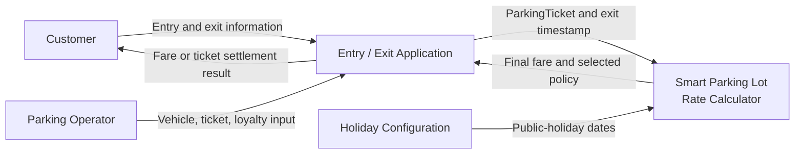

The implemented console is a thin local adapter. Physical entry/exit systems
and customer-facing applications remain outside the assignment scope.

## 2. High-Level Component Architecture

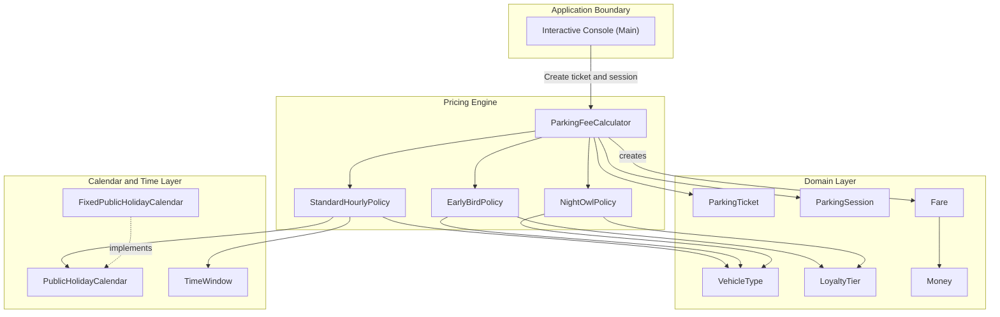

## 3. Package and Dependency View

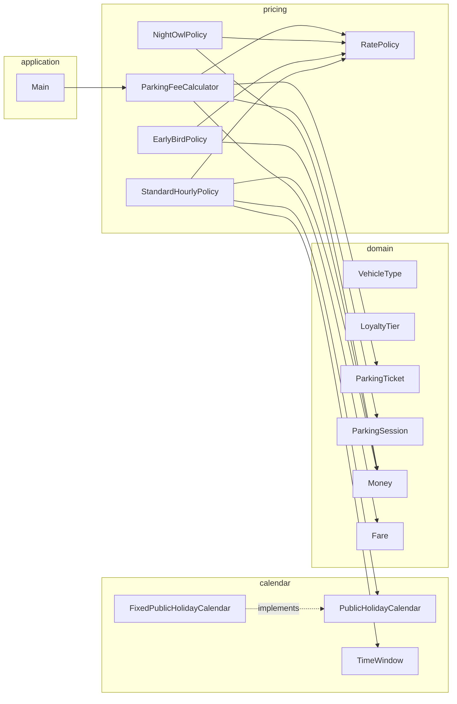

The arrows represent allowed production dependencies. Calendar and policy classes
must not depend on application or adapter classes.

## 4. Domain Object Model

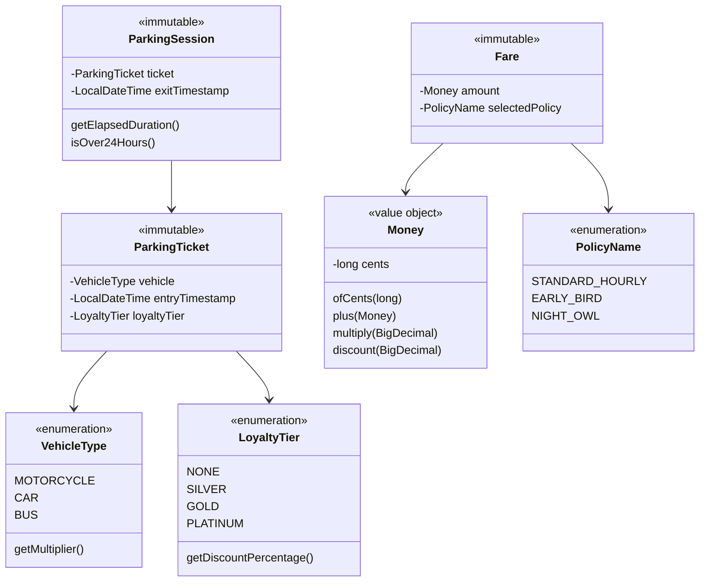

## 5. Policy Contract

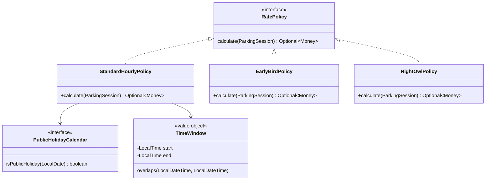

An empty optional means that the policy is not applicable. An amount means that
the policy was valid and produced a fare candidate.

## 6. Minimum-Fare Calculation Sequence

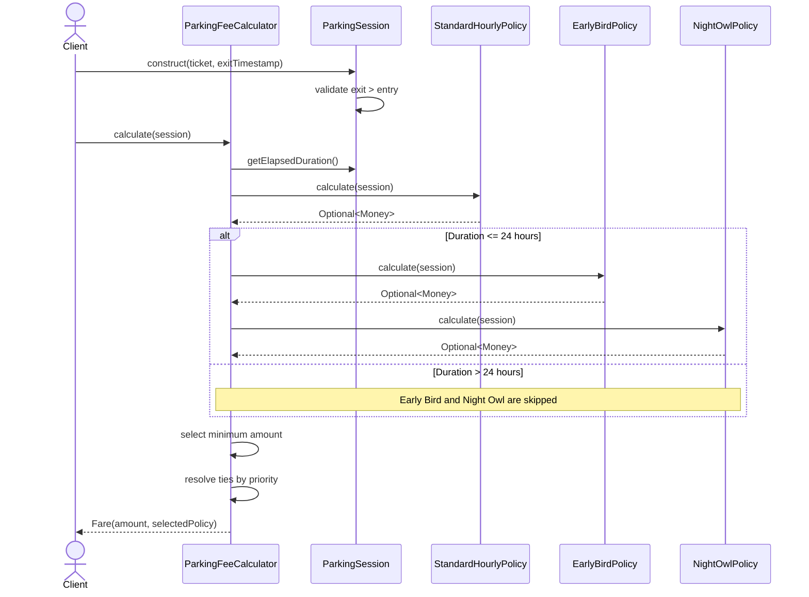

## 7. Standard Hourly Calculation Flow

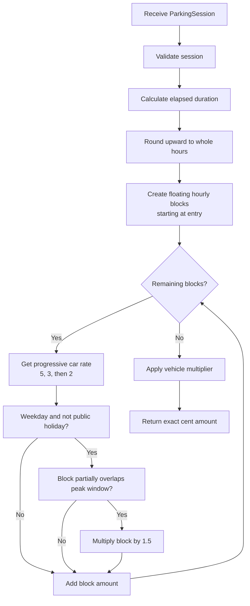

Peak overlap uses:

```text
blockStart < peakWindowEnd
AND
blockEnd > peakWindowStart
```

This handles partial overlap and makes peak ends exclusive.

## 8. Special-Policy Applicability

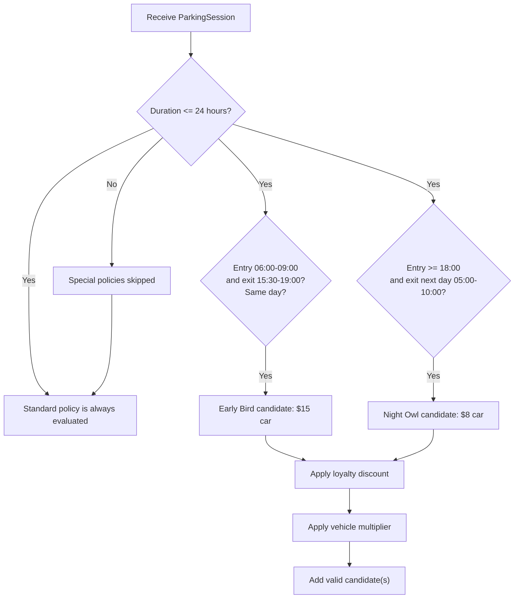

## 9. Tie-Break and Minimum-Fare Decision

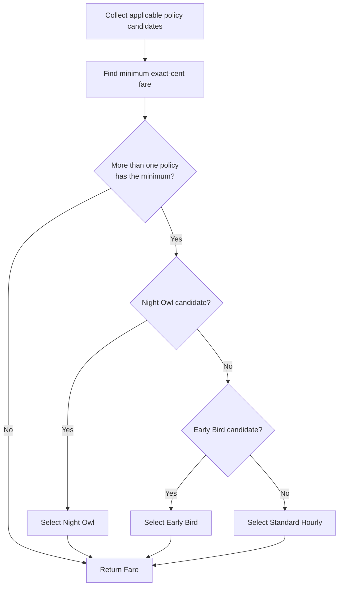

This priority is intentionally documented and may be changed only through a
specification revision.

## 10. Session Validation State

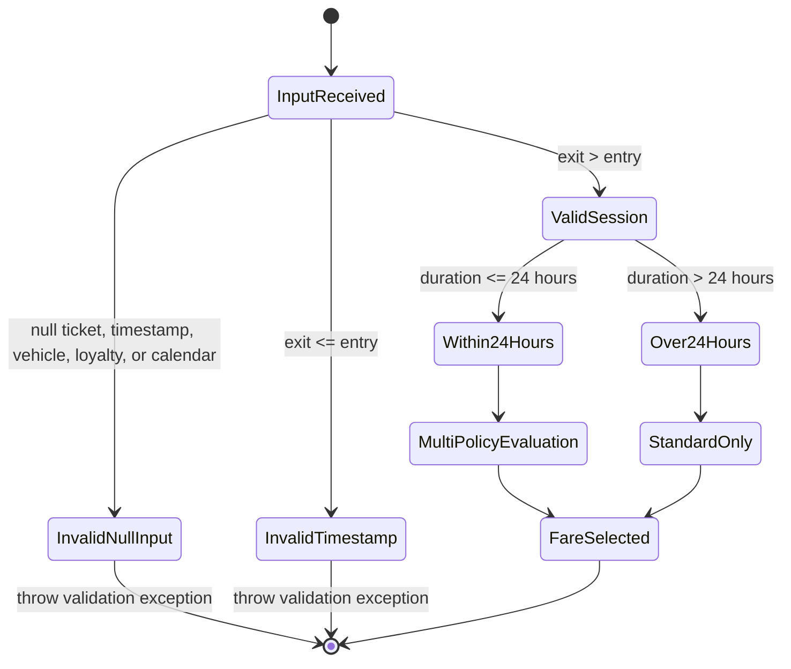

## 11. Negative-Case Decision Map

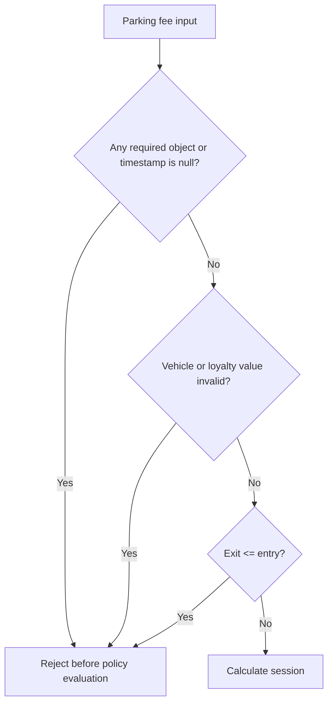

## 12. Deployment View

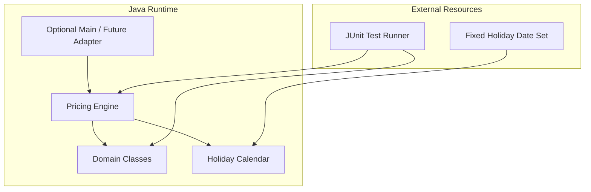

The runtime has no database, network listener, framework container, or external
service dependency.

## 13. Future Adapter Boundary

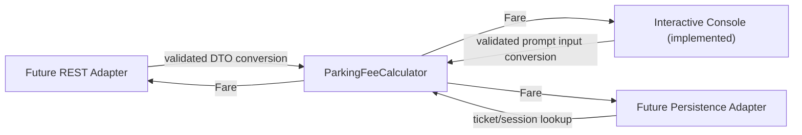

The interactive console is implemented as a thin adapter. REST and persistence
adapters remain future integration options.
